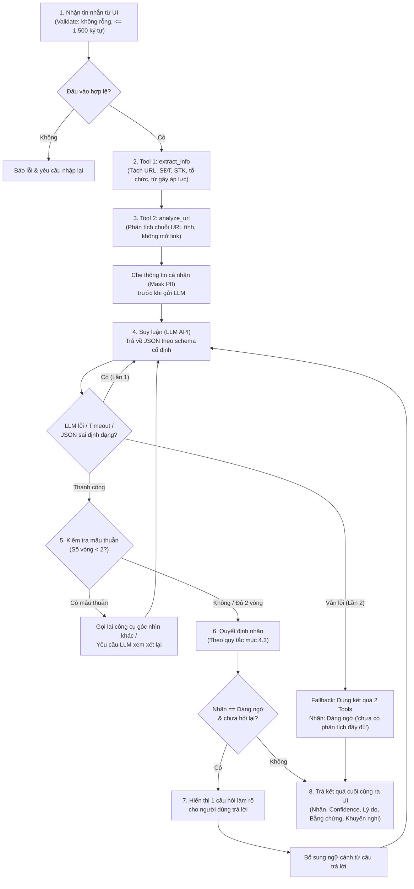

# Kế hoạch Triển khai Code – ScamGuard AI (ScamGuard VN Demo)

> **Dự án:** ScamGuard AI – AI Defend Scam (Bản demo kiểm chứng ý tưởng)  
> **Nhóm thực hiện:** Minh (Dev) · Tú (Tester) · Thuận (BA)  
> **Ngày lập kế hoạch:** 19/11/2026  
> **Mốc đóng băng demo:** 27/11/2026 (`tag v1.0-demo`)  
> **Hạn nộp bài:** Thứ Hai, 30/11/2026  

---

## 1. Mục tiêu & Nguyên tắc Triển khai

### 1.1. Mục tiêu
Xây dựng một bản **demo AI Agent** chạy trọn luồng trên máy local cho **3 tình huống cốt lõi** nhằm chứng minh tính khả thi và quay video báo cáo:
1. **Lừa đảo:** Tin nhắn giả mạo ngân hàng/tổ chức kèm link giả hoặc gây áp lực.
2. **An toàn:** Tin nhắn hợp lệ, không chứa liên kết lạ hay yêu cầu nhạy cảm (ví dụ: OTP thật kèm cảnh báo không chia sẻ).
3. **Đáng ngờ (Ca khó):** Tin nhắn có tín hiệu lẫn lộn hoặc thiếu ngữ cảnh — Agent phải kích hoạt **bước hỏi lại người dùng** trước khi kết luận lại.

### 1.2. Nguyên tắc làm việc
- **Chạy được trước, đẹp sau:** Ưu tiên một luồng xử lý trọn vẹn, ổn định hơn nhiều tính năng dở dang.
- **Đóng băng tính năng vào 27/11:** Sau mốc `v1.0-demo`, chỉ sửa lỗi (bugfix), tuyệt đối không thêm tính năng mới.
- **Làm chủ 100% mã nguồn:** Người code phải hiểu và giải thích được từng module khi quay video (chiếm 20% điểm xét công sức thật).
- **Bảo mật & Quyền riêng tư (PII Masking):** Tuyệt đối **không** gửi thông tin cá nhân thật lên LLM API. Chỉ dùng tin mẫu hoặc che (mask) số điện thoại, họ tên, số tài khoản trước khi gọi LLM.

---

## 2. Phạm vi Dự án (Scope)

### 2.1. Trong phạm vi (In-Scope)
| Thành phần | Mô tả chi tiết |
| :--- | :--- |
| **Đầu vào (Input)** | Đoạn văn bản tin nhắn (SMS, Zalo, iMessage) người dùng dán vào; hỗ trợ tiếng Việt **có dấu và không dấu** (giới hạn ~1.500 ký tự). |
| **Công cụ 1: `extract_info`** | Trích xuất URL, số điện thoại, số tài khoản, tên tổ chức bị mạo danh và các cụm từ gây áp lực/đe dọa (khóa tài khoản, nộp phí, trong 24 giờ...). |
| **Công cụ 2: `analyze_url`** | Chỉ phân tích **chuỗi URL tĩnh**: phát hiện tên miền giả dạng thương hiệu (typosquatting, thay `O` thành `0`, thêm gạch ngang), link rút gọn, đuôi tên miền bất thường, ký tự lạ. **Không truy cập link thật.** |
| **Lõi Agent (`agent/core.py`)** | Vòng lặp `Quan sát → Suy luận → Gọi công cụ → Tổng hợp bằng chứng` kết hợp LLM API. Tối đa **2 vòng kiểm tra** khi có mâu thuẫn. |
| **Đầu ra (Output)** | JSON chuẩn hóa gồm: nhãn (`Lừa đảo` / `An toàn` / `Đáng ngờ`), mức tự tin (`confidence`), lý do, bằng chứng, khuyến nghị và câu hỏi làm rõ (nếu cần). |
| **Giao diện (UI)** | Ứng dụng web 1 trang bằng **Streamlit** hoặc **Gradio** bám sát mockup của BA (Thuận). |

### 2.2. Ngoài phạm vi (Out-of-Scope)
- Tra cứu cơ sở dữ liệu số điện thoại/tài khoản lừa đảo, tích hợp API ngân hàng hoặc cơ quan nhà nước.
- Truy cập, tải trang hoặc mở bất kỳ đường link nào có trong tin nhắn.
- Tự động đọc tin nhắn từ điện thoại, ứng dụng di động hay tiện ích trình duyệt.
- Đăng nhập, phân quyền, lưu trữ lịch sử hoặc dữ liệu người dùng.
- Huấn luyện mô hình ML, xây bộ dữ liệu lớn, chạy baseline/ablation.
- Xử lý hình ảnh, mã QR, giọng nói hoặc cuộc gọi thoại.
- Triển khai lên máy chủ production (chỉ chạy demo local & quay video).

---

## 3. Người dùng Mục tiêu & User Stories

### 3.1. Nhóm người dùng mục tiêu
- **Người lớn tuổi, ít kinh nghiệm công nghệ:** Cần giải thích ngắn gọn, dễ hiểu, ít thuật ngữ, chỉ rõ việc cần làm tiếp theo.
- **Sinh viên, người đi làm bận rộn:** Cần kết quả trong vài giây với bằng chứng súc tích.
- **Người thân kiểm tra hộ:** Cần định dạng kết quả rõ ràng để dễ chụp/chuyển tiếp lại cho ông bà, cha mẹ.

### 3.2. Danh sách User Stories (theo thứ tự ưu tiên)
1. **[P0]** Là người dùng, tôi dán một tin nhắn và nhận ngay nhãn `Lừa đảo`, `An toàn` hoặc `Đáng ngờ`.
2. **[P0]** Là người dùng, tôi muốn xem lý do và bằng chứng cụ thể (link giả, mạo danh, đe dọa) để tin tưởng kết quả.
3. **[P0]** Là người dùng, tôi muốn biết khuyến nghị hành động tiếp theo (không bấm link, không đưa OTP, liên hệ kênh chính thức).
4. **[P1]** Là người dùng, khi tin nhắn mơ hồ (`Đáng ngờ`), tôi muốn Agent hỏi lại 1 câu làm rõ thay vì phán đoán bừa.
5. **[P1]** Là người dùng, tôi muốn Agent xử lý tốt cả tin nhắn viết không dấu hoặc viết tắt.

---

## 4. Workflow của Agent

### 4.1. Sơ đồ luồng xử lý tổng thể



### 4.2. Ranh giới tự chủ (Human-in-the-Loop)
| Agent tự thực hiện | Người dùng quyết định |
| :--- | :--- |
| Tách thông tin (`extract_info`), phân tích chuỗi URL (`analyze_url`). | Quyết định có làm theo khuyến nghị hay không. |
| Suy luận, chọn công cụ, kiểm tra lại khi bằng chứng mâu thuẫn. | Trả lời câu hỏi làm rõ khi kết quả là `Đáng ngờ`. |
| Đưa ra nhãn phân loại, mức tự tin, lý do, bằng chứng và khuyến nghị. | Tự quyết định chặn số điện thoại hoặc báo cáo cơ quan chức năng. |

> **Ràng buộc an toàn:** Agent **không** tự chặn số, **không** tự báo cáo, **không** tự trả lời hộ người dùng và **không** mở link.

### 4.3. Quy tắc ra nhãn (Labeling Rules)
- **`Lừa đảo`:** Có dấu hiệu mạo danh tổ chức (ngân hàng, cơ quan nhà nước, điện lực, bưu chính...) **VÀ** có ít nhất 1 tín hiệu mạnh: link giả/rút gọn, đe dọa/áp lực thời gian, yêu cầu cung cấp OTP/mật khẩu, hoặc yêu cầu chuyển tiền/nộp phí.
- **`An toàn`:** Không có link lạ, không yêu cầu hành động tài chính hay thông tin nhạy cảm, nội dung thông thường (ví dụ: tin OTP thật kèm cảnh báo không chia sẻ mã).
- **`Đáng ngờ`:** Tín hiệu lẫn lộn hoặc thiếu ngữ cảnh. **Nguyên tắc ưu tiên an toàn:** Khi phân vân giữa `An toàn` và `Đáng ngờ`, luôn nghiêng về `Đáng ngờ` (vì bỏ sót lừa đảo nguy hiểm hơn báo động giả), kèm câu hỏi làm rõ và khuyến nghị thận trọng.

### 4.4. Định dạng đầu ra JSON chuẩn (Output Contract)
```json
{
  "label": "Lừa đảo | An toàn | Đáng ngờ",
  "confidence": 0.85,
  "reasons": [
    "Mạo danh ngân hàng kèm lời đe dọa khóa tài khoản trong 24 giờ.",
    "Chứa đường link giả dạng thương hiệu với đuôi tên miền bất thường."
  ],
  "evidence": [
    {
      "tool": "extract_info",
      "finding": "Phát hiện cụm từ gây áp lực: 'khóa tài khoản', 'trong 24 giờ'."
    },
    {
      "tool": "analyze_url",
      "finding": "Tên miền 'vietc0mbank-verify.xyz' thay chữ 'o' bằng số '0' và dùng đuôi '.xyz'."
    }
  ],
  "recommendation": [
    "Không bấm vào đường link trong tin nhắn.",
    "Không cung cấp mã OTP, mật khẩu hay thông tin tài khoản.",
    "Liên hệ trực tiếp qua ứng dụng hoặc kênh chăm sóc khách hàng chính thức của tổ chức."
  ],
  "follow_up_question": null
}
```
> **Lưu ý:** Mục `recommendation` chỉ đưa ra khuyến nghị hành động chung, **không tự bịa số hotline cụ thể** trong code hay prompt.

### 4.5. Cơ chế xử lý lỗi (Error Handling)
1. **Input rỗng hoặc > 1.500 ký tự:** Chặn ngay ở bước 1 và nhắc người dùng nhập lại.
2. **LLM lỗi kết nối / hết thời gian chờ (timeout):** Tự động thử lại **1 lần**. Nếu vẫn lỗi → chuyển sang chế độ **Fallback**: tổng hợp kết quả từ 2 công cụ rule-based, gắn nhãn `Đáng ngờ` và ghi chú `"Chưa có phân tích đầy đủ từ AI"`.
3. **LLM trả về JSON sai định dạng / thiếu trường:** Thử lại **1 lần** kèm nhắc định dạng. Nếu vẫn sai → áp dụng chế độ **Fallback** tương tự trên.

---

## 5. Kiến trúc Hệ thống & Công nghệ

### 5.1. Tech Stack đề xuất
- **Ngôn ngữ:** Python 3.11
- **Tools (Rule-based):** `re` (regex), `urllib.parse`, `unicodedata` (chuẩn hóa tiếng Việt không dấu) và thư viện chuẩn Python.
- **LLM API:** Ưu tiên model nhỏ, tốc độ nhanh, chi phí thấp, hỗ trợ JSON mode tốt (lưu API key trong `.env`, tuyệt đối không commit lên Git).
- **Giao diện (GUI):** Streamlit (hoặc Gradio) — ưu tiên gọn nhẹ, hỗ trợ state cho bước hỏi lại.
- **Kiểm thử:** `pytest` cho unit test công cụ.
- **Quản lý mã nguồn:** Git.

### 5.2. Cấu trúc thư mục dự án
```text
ScamGuard - Called Defend Scam/
├── app.py                     # Giao diện web demo (Streamlit / Gradio)
├── agent/
│   ├── __init__.py
│   ├── core.py                # Vòng lặp agent, điều phối tools, kiểm tra mâu thuẫn, fallback
│   └── prompts.py             # System prompt, few-shot examples, định nghĩa JSON schema
├── tools/
│   ├── __init__.py
│   ├── extract_info.py        # Công cụ 1: tách URL, SĐT, STK, tổ chức, từ gây áp lực & mask PII
│   └── analyze_url.py         # Công cụ 2: phân tích chuỗi URL tĩnh (giả thương hiệu, rút gọn, đuôi lạ)
├── data/
│   └── test_messages.json     # Bộ tin nhắn mẫu lấy từ sheet Test scenario
├── tests/
│   └── test_tools.py          # Unit test cho extract_info và analyze_url
├── .env.example               # Mẫu biến môi trường (LLM_API_KEY, MODEL_NAME...)
├── .gitignore                 # Bỏ qua .env, __pycache__, .venv...
├── requirements.txt           # Danh sách thư viện cần cài đặt
├── IMPLEMENTATION_PLAN.md     # Tài liệu kế hoạch triển khai này
└── README.md                  # Hướng dẫn cài đặt và chạy demo trong 3 lệnh
```

### 5.3. Quy ước Git (Git Workflow)
- Nhánh `main` **luôn ở trạng thái chạy được**.
- Phát triển tách biệt theo nhánh tính năng:
  - `feature/tools`: Xây dựng `extract_info.py`, `analyze_url.py` và `tests/test_tools.py`.
  - `feature/agent`: Xây dựng `agent/prompts.py`, `agent/core.py` và luồng CLI.
  - `feature/gui`: Xây dựng giao diện `app.py` theo mockup của Thuận.
- Merge vào `main` sau khi tự kiểm thử pass.
- Gắn tag **`v1.0-demo`** vào ngày **27/11/2026** khi đóng băng bản demo.

---

## 6. Roadmap Triển khai (19/11 – 30/11/2026)

| Thời gian | Giai đoạn / Công việc | Mã việc | Người phụ trách | Kết quả cần đạt (Deliverables) |
| :--- | :--- | :---: | :---: | :--- |
| **19–21/11** | Thiết kế kiến trúc, chọn LLM provider/model, dựng repo, gọi thử LLM API thành công | `1.2` | Minh (Dev) + Thuận | Sơ đồ kiến trúc được BA duyệt; repo sẵn sàng; gọi thử API thành công |
| **21–22/11** | Nhận đặc tả luồng từ BA, chốt khung đầu ra JSON và bộ quy tắc nhãn | `1.1` | Minh + Thuận + Tú | Chốt cứng JSON Schema & Labeling Rules |
| **22–23/11** | Code 2 công cụ (`extract_info`, `analyze_url`), hàm mask PII và viết unit test | `2.1` | Minh | `pytest` pass 100% với tin mẫu có dấu và không dấu |
| **23–25/11** | Code lõi Agent (`core.py`), viết prompt (`prompts.py`), xử lý mâu thuẫn & fallback | `2.2` | Minh | **Mốc kiểm tra C1 (25/11):** Chạy trọn 3 tình huống demo từ dòng lệnh (CLI) |
| **25–26/11** | Xây dựng giao diện 1 trang theo mockup của BA, nối với Agent core & bước hỏi lại | `2.3` | Minh | **Mốc kiểm tra C2 (26/11):** Dán tin trên UI, thấy nhãn, lý do, bằng chứng, khuyến nghị & hỏi lại |
| **26–27/11** | Chạy ~20 kịch bản kiểm thử trên sheet Test scenario, log bug và sửa lỗi theo ưu tiên | `3.1–3.3` | Tú (Test) + Minh (Fix) | Hoàn thành xử lý các lỗi nghiêm trọng & ưu tiên cao |
| **27/11** | **Đóng băng bản demo** | `3.3` | Minh + Tú | Tạo **`tag v1.0-demo`**; bản demo chạy ổn định trên máy quay video |
| **27–28/11** | Tập chạy kịch bản demo, viết phần kiến trúc & Agent cho báo cáo | `4.2, 4.4` | Cả nhóm | Kịch bản demo hoàn chỉnh; hoàn thiện phần Agent trong báo cáo |
| **28–29/11** | Quay video demo (Tú dẫn), kiểm tra lại và nộp bài trước hạn | `4.5, 4.7` | Tú + Cả nhóm | Link YouTube video demo; ảnh xác nhận nộp bài (trước 30/11) |

### Định nghĩa Hoàn thành (Definition of Done – DoD)
- [ ] Chạy trọn 3 tình huống demo (`Lừa đảo`, `An toàn`, `Đáng ngờ`) không phát sinh lỗi trên máy trình bày.
- [ ] Mỗi kết quả hiển thị đầy đủ: nhãn, mức tự tin, lý do, bằng chứng từ công cụ và khuyến nghị an toàn.
- [ ] Tình huống `Đáng ngờ` thực hiện được bước hỏi lại và cập nhật kết quả sau khi người dùng trả lời.
- [ ] `README.md` ngắn gọn, cho phép Tester cài đặt và chạy lại trong vài phút (tối đa 3 lệnh).

---

## 7. Kế hoạch Kiểm thử (Testing Strategy)

### 7.1. Unit Test cho Công cụ (`tests/test_tools.py`)
Bắt buộc bao phủ các trường hợp biên:
- URL dính dấu chấm/dấu phẩy cuối câu (ví dụ: `https://abc.xyz.`).
- Link rút gọn (`bit.ly`, `tinyurl.com`, `t.co`, `s.id`, `bom.so`...).
- Tên miền giả thương hiệu: thay chữ `o` bằng `0`, `l` bằng `1`, thêm gạch ngang (`vietc0mbank-vn.com`, `vcb-support.xyz`).
- Số điện thoại nhiều định dạng (`09xx`, `+84xxx`, có dấu cách hoặc dấu chấm).
- Tin nhắn tiếng Việt **không dấu** hoặc viết tắt (`tk bi khoa`, `xac minh ngay`, `gui ma otp`).

### 7.2. Kiểm thử Agent (~20 kịch bản)
- Tester (Tú) chạy ~20 kịch bản trong sheet **Test scenario**, ghi nhận nhãn dự đoán của Agent và đánh giá `Pass / Fail`.
- Sheet **Tổng hợp** tự động tính `Confusion Matrix`, `Precision`, `Recall`.
- **Nguyên tắc đánh giá khách quan:** Không hardcode hoặc chỉnh sửa riêng lẻ cho từng kịch bản test; mỗi lần điều chỉnh prompt phải **chạy lại toàn bộ 20 kịch bản**. Ghi rõ trong báo cáo rằng kết quả đo lường mang tính minh họa do cỡ mẫu nhỏ.

---

## 8. Quản lý Rủi ro & Phương án Dự phòng

### 8.1. Thứ tự cắt giảm phạm vi nếu trễ tiến độ
*(Cắt từ dưới lên, tuyệt đối giữ nguyên luồng chính chạy trọn 3 tình huống)*
1. **Cắt mức 1 (ưu tiên cắt trước):** Giao diện web → Chuyển sang chạy dòng lệnh (CLI) quay màn hình, đưa mockup UI vào báo cáo.
2. **Cắt mức 2:** Bước hỏi lại tương tác trong code → Minh họa bằng mockup và kịch bản trong báo cáo/video.
3. **Cắt mức 3:** Phân tích URL nâng cao → Chỉ giữ phát hiện link rút gọn và tên miền giả thương hiệu cơ bản.
4. **Cắt mức 4:** Vòng quay lại kiểm tra mâu thuẫn → Giảm từ tối đa 2 lượt xuống còn 1 lượt.

### 8.2. Ma trận rủi ro & Cách xử lý
| Rủi ro | Mức độ | Phương án phòng ngừa & Xử lý |
| :--- | :---: | :--- |
| **Chi phí hoặc giới hạn rate limit API** | Cao | Dùng model nhỏ/rẻ, giới hạn input <= 1.500 ký tự, cache/lưu sẵn kết quả 3 ca demo để chạy lại không tốn quota. |
| **LLM trả lời không ổn định / sai JSON** | Cao | Bật JSON mode (nếu có), thêm few-shot examples trong prompt, retry 1 lần và có Fallback dựa trên 2 tools. |
| **Mạng yếu / API lỗi lúc quay video** | Trung bình | Quay video trước mốc nộp, lưu sẵn kết quả mẫu của 3 tình huống làm phương án dự phòng. |
| **Lộ API Key lên Git** | Cao | Đọc key từ biến môi trường (`.env`), thêm `.env` vào `.gitignore` ngay từ commit đầu tiên, cung cấp `.env.example`. |
| **Dev quá tải tiến độ** | Trung bình | Tú hỗ trợ viết dữ liệu tin mẫu (`test_messages.json`) và test công cụ; Thuận soạn prompt nháp dựa trên quy tắc nhãn. |

---

## 9. Checklist Việc Cần Chốt Ngay Hôm Nay (19/11/2026)

- [ ] **1. Chọn LLM Provider & Model:** Chốt dịch vụ (Gemini / OpenAI / Groq...), xác nhận người giữ API key và hạn mức ngân sách.
- [ ] **2. Chốt Output JSON Contract:** Thống nhất khung JSON ở mục 4.4 và quy tắc nhãn ở mục 4.3 với Thuận (BA) và Tú (Tester).
- [ ] **3. Chốt máy Demo & Quay video:** Xác định máy tính sẽ chạy demo chính thức và cài sẵn Python 3.11 + môi trường ảo.
- [ ] **4. Khởi tạo Repo & Quy ước nhánh:** Push cấu trúc khung + `.gitignore` lên repo chung, mời Thuận và Tú tham gia, áp dụng quy ước nhánh (`feature/tools`, `feature/agent`, `feature/gui`).
